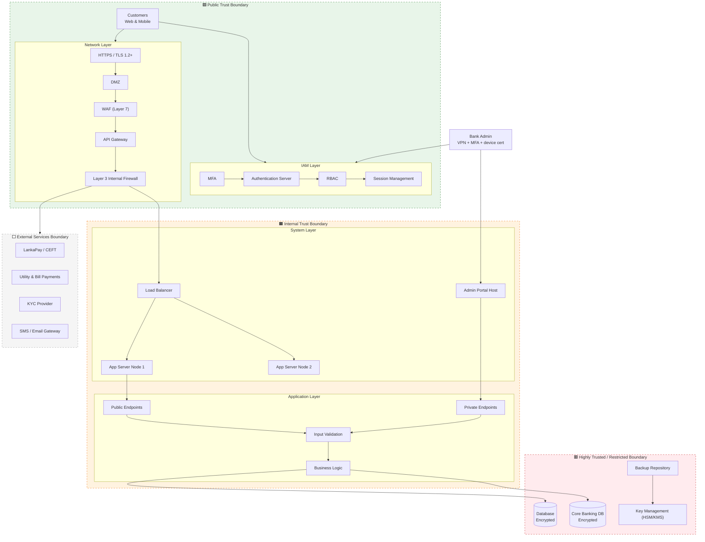

# Secure Architecture and Threat Analysis – People's Bank Online Banking System
 


 
A layered security architecture and threat analysis of a Sri Lankan online banking platform: **People's Pay** (mobile wallet), **People's Wave** (mobile banking) and **Internet Banking** (web portal).
 
The analysis looks at the platform end to end. It identifies critical assets and key risks, then defines a testable **security requirements specification (SRS)**. It designs controls for identity, network, platform, application, data, detection, resilience and compliance, and traces every requirement back to the controls that implement it.
 
## Result
 
| | |
|---|---|
| **Grade** | **79 / 100** |
| **Module** | Cyber Security · BSc (Hons) Computing · Coventry University (via NIBM) |
| **Assessment** | Written report (~4,500 words) + viva |
 
> *"A solid and well-rounded submission demonstrating a good understanding of both the security requirements and the deployment environment. The SRS was clearly articulated and Part B showed a thoughtful approach to the security apparatus. The viva performance was strong, reflecting genuine engagement with the material. A commendable piece of work overall."*
> — Instructor feedback
 
The full report is available on request.
 
> **Academic disclaimer:** this is an independent academic analysis completed for the Cyber Security module of the BSc (Hons) Computing programme (Coventry University, UK, via NIBM). It is based only on publicly available information. It is **not affiliated with or endorsed by People's Bank**, and it does **not** describe the bank's actual internal infrastructure or controls. All controls, thresholds and intervals are a *proposed reference design*.
 
---
 
## Result
 
| | |
|---|---|
| **Module** | Cyber Security, BSc (Hons) Computing, Coventry University (via NIBM) |
| **Grade** | **79 / 100 (First Class)** |
| **Assessment** | Written report (38 pages) and viva |
 
> *"A solid and well-rounded submission demonstrating a good understanding of both the security requirements and the deployment environment. The SRS was clearly articulated and Part B showed a thoughtful approach to the security apparatus. The viva performance was strong, reflecting genuine engagement with the material. A commendable piece of work overall."*
>
> — Module instructor
 
The full report is available on request. Contact me via [LinkedIn](https://www.linkedin.com/in/umandi-de-silva-9b88a423b).
 
---
 
## Highlights
 
| Area | What this analysis covers |
|---|---|
| **Result** | **79/100 (First Class)**, with a strong viva |
| **Threat analysis** | 9 critical asset groups, 10 key risks, 13 integrations, including CEFT/LankaPay, core banking, AML and KYC |
| **Security requirements** | 13 requirements across IAM, network, system, application and data layers, each with **pass/fail acceptance tests** |
| **Identity & access** | MFA for all users, RBAC with 6 roles, admin access only over VPN from certificate-verified devices, secrets kept in a vault or HSM |
| **Network** | DMZ, then WAF, then API gateway, then a segmented internal network (application, database, integration and admin zones); TLS 1.2+ everywhere and mTLS for sensitive calls |
| **Application security** | OWASP Top 10 secure coding, parameterised queries, output encoding, short-lived JWTs with refresh-token rotation, CSRF tokens, SAST/DAST in CI/CD |
| **Data protection** | TDE, column-level encryption for NIC, card and account numbers, masking, key rotation in HSM, SHA-256 integrity checks on backups |
| **Detection & response** | SIEM alerting rules, IDS/IPS, fraud monitoring, a 5-step incident response process with CBSL reporting |
| **Resilience** | High-availability design, automatic failover, **RPO 15 minutes / RTO 1–2 hours**, rate limiting |
| **Compliance** | CBSL guidelines plus 6 Sri Lankan Acts, 7-year tamper-proof audit logs |
 
---
 
## Architecture at a glance
 

 
The full draw.io diagram with icons and trust boundaries is in [`assets/architecture-diagram.png`](assets/architecture-diagram.png). [Architecture](docs/02-architecture.md) explains it in detail.
 
---
 
## Documentation
 
### Part A – Context, risks and requirements
| # | Document | Contents |
|---|---|---|
| 01 | [System Context](docs/01-system-context.md) | Business purpose, the three applications, system tiers, critical assets, roles, integrations |
| 02 | [Architecture](docs/02-architecture.md) | Trust boundaries, layers, request flows, diagram |
| 03 | [Threat Model](docs/03-threat-model.md) | Key risks mapped to affected assets and mitigating controls |
| 04 | [Security Requirements (SRS)](docs/04-security-requirements.md) | 13 requirements with acceptance tests |
 
### Part B – Security controls
| # | Document | Contents |
|---|---|---|
| 05 | [Target Environment & Shared Responsibility](docs/05-shared-responsibility.md) | Hybrid cloud and on-premises split; cloud, on-premises and third-party responsibility matrices |
| 06 | [Identity, AuthN/AuthZ & Secrets](docs/06-identity-access.md) | Identities, customer and admin authentication, RBAC roles, secrets management |
| 07 | [Network & Platform Security](docs/07-network-platform.md) | DMZ, Layer 3 rules, TLS everywhere, zone segmentation, API gateway, CIS hardening |
| 08 | [Application Security Engineering](docs/08-application-security.md) | OWASP secure coding, endpoint segregation, session security, CI/CD security, penetration testing scope |
| 09 | [Data Protection](docs/09-data-protection.md) | Encryption at rest and in transit, key management, backups |
| 10 | [Observability, Detection & Response](docs/10-detection-response.md) | SIEM, dashboards, alert rules, IDS/IPS, fraud monitoring, incident response |
| 11 | [Resilience & Reliability](docs/11-resilience.md) | High availability, failover, disaster recovery targets, rate limits |
| 12 | [Compliance, Privacy & Audit](docs/12-compliance-audit.md) | CBSL, Sri Lankan legislation, privacy principles, audit programme |
| 13 | [Traceability Matrix](docs/13-traceability-matrix.md) | Every SRS requirement mapped to the controls that implement it |
| — | [References](docs/references.md) | Sources |
 
---
 
## Repository structure
 
```
.
├── README.md
├── assets/
│   └── architecture-diagram.png
└── docs/
    ├── 01-system-context.md
    ├── 02-architecture.md
    ├── 03-threat-model.md
    ├── 04-security-requirements.md
    ├── 05-shared-responsibility.md
    ├── 06-identity-access.md
    ├── 07-network-platform.md
    ├── 08-application-security.md
    ├── 09-data-protection.md
    ├── 10-detection-response.md
    ├── 11-resilience.md
    ├── 12-compliance-audit.md
    ├── 13-traceability-matrix.md
    └── references.md
```
 
## Skills demonstrated
 
`Threat modelling` · `Security requirements engineering` · `Defence-in-depth architecture` · `IAM (MFA, RBAC, session management)` · `Network segmentation & zero trust` · `OWASP Top 10` · `Secure SDLC (SAST/DAST)` · `Encryption & key management` · `SIEM & incident response` · `Business continuity / DR` · `Regulatory compliance (CBSL)` · `Requirements traceability`
 
## Author
 
**M. H. T. Umandi de Silva**, BSc (Hons) Computing, Coventry University (NIBM)
[LinkedIn](https://www.linkedin.com/in/umandi-de-silva-9b88a423b) · [GitHub](https://github.com/ThisaruUmandi)
 
---
 
<sub>© M. H. T. Umandi de Silva. Shared for portfolio purposes. Please do not reproduce or submit this work for academic credit.</sub>
 
