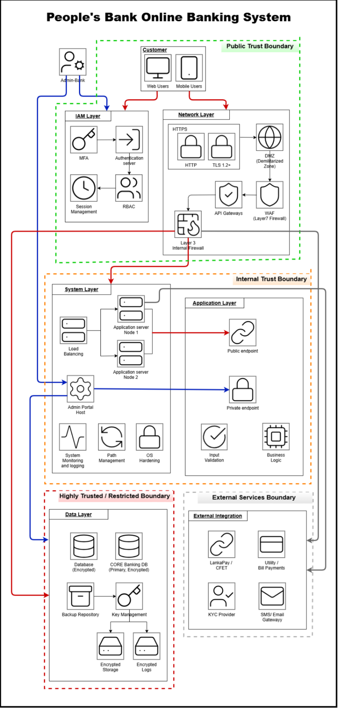
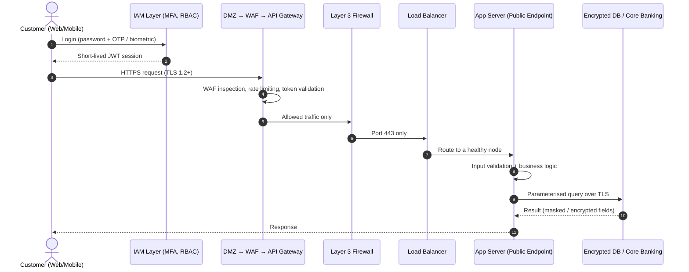
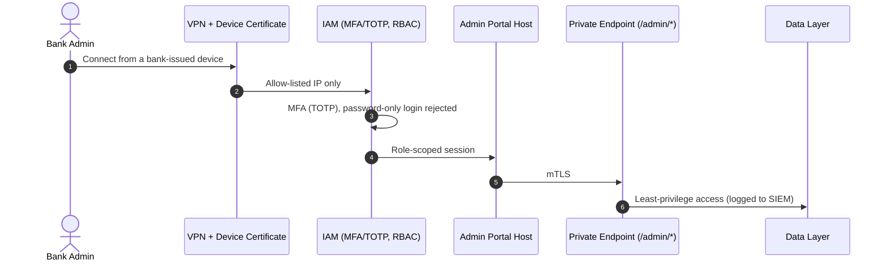

# 02 · Architecture

[← System Context](01-system-context.md) · [README](../README.md) · Next: [Threat Model →](03-threat-model.md)

## Trust boundaries

The architecture is split into four trust boundaries. Trust increases towards the data layer, and every crossing between boundaries is controlled.

| Boundary | Trust level | Contains |
|---|---|---|
| 🟩 **Public Trust Boundary** | Untrusted / internet-facing | Customers (web and mobile), IAM layer, network layer (HTTPS/TLS, DMZ, WAF, API gateway, Layer 3 firewall) |
| 🟧 **Internal Trust Boundary** | Trusted internal | System layer (load balancer, application server nodes, admin portal host, monitoring, patching, OS hardening) and application layer (public and private endpoints, input validation, business logic) |
| 🟥 **Highly Trusted / Restricted Boundary** | Most sensitive | Data layer: encrypted database, encrypted core banking DB, backup repository, key management, encrypted storage and logs |
| ⬜ **External Services Boundary** | Third party | LankaPay/CEFT, utility and bill payments, KYC provider, SMS/email gateway |

## Layers

| Layer | Components |
|---|---|
| **IAM** | MFA, authentication server, RBAC, session management |
| **Network** | HTTPS (TLS 1.2+), DMZ, WAF (Layer 7), API gateway, Layer 3 internal firewall |
| **System** | Load balancer, application server nodes 1 and 2, admin portal host, system monitoring and logging, patch management, OS hardening |
| **Application** | Public endpoints, private endpoints, input validation, business logic |
| **Data** | Encrypted database, encrypted core banking DB (primary), backup repository, key management, encrypted storage, encrypted logs |
| **External integration** | LankaPay/CEFT, utility and bill payments, KYC provider, SMS/email gateway |

## Request flows

### Customer flow (red path)

### Admin flow (blue path)

### Integration flow (grey path)
The Layer 3 firewall routes traffic to the **External Services Boundary** through a dedicated **integration zone**. Outbound calls to LankaPay/CEFT, billers, KYC and SMS/email use TLS, managed API keys and allow-lists. All inputs and outputs are validated, and integration failures are monitored.

## Design principles

- **Defence in depth:** independent controls at every layer (WAF, then API gateway, then firewall, then validation, then encryption).
- **Least privilege:** RBAC for every role, and admin access only through VPN, MFA and certified devices.
- **Zero trust between zones:** zones communicate only through strict firewall rules.
- **Secure by default:** TLS everywhere, encryption at rest, no secrets in code.
- **Observability:** every security-relevant event flows into the SIEM.
