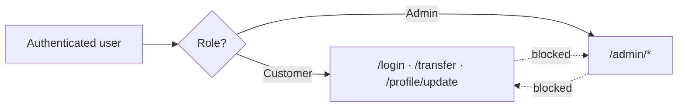

# 06 · Identity, Authentication, Authorisation & Secrets

[← Shared Responsibility](05-shared-responsibility.md) · [README](../README.md) · Next: [Network & Platform →](07-network-platform.md)

Identity and access is one of the most critical areas of a banking system, because both customer and admin users work with sensitive financial data.

## Identity

| Identity | Used by |
|---|---|
| **Pay ID** | Customers |
| **Account number** | Backend systems, linked to a service account |
| **Staff ID** | Privileged bank staff (admin login) |

## Authentication (AuthN)

### Customers
- 2FA / MFA must be enabled.
- Login uses a password, with an optional biometric identifier (mobile only).
- **Mandatory MFA / OTP for sensitive actions:** fund transfers, adding payees, changing profile details.
- Session tokens are stored in **secure cookies**.
- **Automatic logout after 5 minutes** of inactivity.

### Admins (high-security zone)
- Authenticate over **VPN with MFA (TOTP)**.
- MFA / 2FA is mandatory, and **password-only login is not allowed**.
- Access only from **bank-issued devices** verified by **endpoint certificates**.

## Authorisation (AuthZ): RBAC

### Customer roles
| Role | Permissions |
|---|---|
| **Regular customer** | View balances and transaction history, transfer funds, pay bills, make QR payments, update personal information |
| **Staff-customer** | Same as a regular customer, **except** transfers between two staff-customer accounts through online banking (a separation-of-duties control) |

### Administration roles
| Role | Permissions |
|---|---|
| **System Administrator** | Manage configuration |
| **Fraud Analyst** | Monitor suspicious activity |
| **Customer Support Officer** | Limited, view-only access |
| **Audit Officer** | View logs and reports, generate reports |

## Secrets management

**What counts as a secret:** database and service passwords, API keys and tokens for external services, encryption keys, TLS/SSL certificates, OAuth and authentication tokens.

| Control | Detail |
|---|---|
| Storage | All secrets live in a **vault or HSM**, never in config files |
| Rotation | Rotated automatically **every 90 days** |
| Certificates | Managed through the bank's own certificate system |
| Database credentials | Kept in the vault and **fetched at runtime** |
