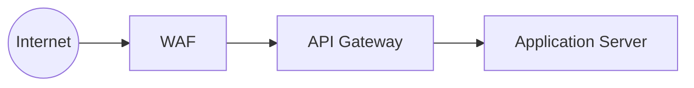

# 07 · Network & Platform Security

[← Identity & Access](06-identity-access.md) · [README](../README.md) · Next: [Application Security →](08-application-security.md)

The hybrid architecture uses a **layered, segmented network**, so attackers have to get through several independent barriers.

## Network security

### DMZ segmentation
The **DMZ** is the bridge between the public internet and the internal network, so public traffic never touches sensitive systems directly. It holds only the components that must face the internet:

| Component | Role |
|---|---|
| **WAF** | Inspects every request for SQL injection, bots, brute force and similar attacks |
| **API gateway** | Controls which APIs are exposed; applies rate limits and authentication |
| **DDoS protection** | Absorbs traffic floods |
| **Load balancer** | Sends traffic only to healthy servers |

### Layer 3 firewall rules
These rules filter traffic by IP address, source, destination and protocol (TCP/UDP).

| Rule | Purpose |
|---|---|
| Only **port 443 (HTTPS)** is open from the internet | Lets in secure web traffic only |
| Databases are **unreachable** from the DMZ or the internet | Even an attacker who knows a database IP cannot reach it |
| Admin access only from **approved office, device or VPN IPs** | Restricts the privileged surface |

### TLS everywhere
- **TLS 1.2+** on all external and service-to-service traffic, which prevents eavesdropping and tampering.
- **Mutual TLS (mTLS)** for admin and sensitive service calls.

### Internal network segmentation (zero trust)
Zones talk to each other only through strict firewall rules.

| Zone | Contains |
|---|---|
| **Application zone** | Application servers |
| **Database zone** | Databases and HSM |
| **Integration zone** | External integrations: LankaPay/CEFT, KYC, bill APIs |
| **Admin zone** | Monitoring, SIEM, VPN, IAM |

### API gateway enforcement
| Control | Purpose |
|---|---|
| Rate limiting | Blocks too many requests from one source (brute force) |
| Token validation | Every request must carry a valid token |
| Threat detection | Catches bots and suspicious behaviour before they reach the backend |
| IP filtering | Restricts sensitive areas by location and IP |

## Platform security

### Server hardening
- All servers are hardened to the **CIS (Center for Internet Security) Benchmarks**.
- Only the services each server needs are installed, and default accounts are disabled.

### Monitoring and logging
All servers and applications are monitored continuously. Failed logins, file modifications and unauthorised access attempts trigger **SIEM alerts**.
