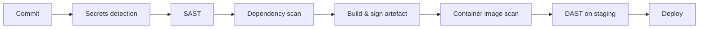

# 08 · Application Security Engineering

[← Network & Platform](07-network-platform.md) · [README](../README.md) · Next: [Data Protection →](09-data-protection.md)

Online banking applications handle highly sensitive financial and personal data. The application layer has to block common web attacks, keep business logic secure, and accept only trusted, validated requests.

## Secure coding practices (aligned with the OWASP Top 10)

| Practice | Description |
|---|---|
| **Input validation** | Check that input matches the expected format, and reject anything that doesn't |
| **Input sanitisation** | Strip dangerous characters (`<`, `>`, `'`, `"`) that enable XSS or SQL injection |
| **Parameterised queries** | Never concatenate user input into SQL |
| **Output encoding** | Make sure user-supplied data is never executed as code (framework built-ins) |
| **SAST** | Static analysis during the build finds insecure code, vulnerable dependencies and coding flaws before deployment |
| **DAST** | Dynamic testing of the running application finds injection risks, session weaknesses and misconfiguration |

**Example of a parameterised query (C# / ADO.NET):**
```csharp
// ✅ Safe: input is bound as a parameter, never concatenated
using var cmd = new SqlCommand(
    "SELECT Balance FROM Accounts WHERE AccountNo = @acc AND CustomerId = @cid", conn);
cmd.Parameters.AddWithValue("@acc", accountNo);
cmd.Parameters.AddWithValue("@cid", customerId);
```

## Endpoint segregation

| Type | Endpoints | Audience |
|---|---|---|
| **Public** | `/login`, `/register`, `/transfer`, `/profile/update` | Customers |
| **Private** | `/admin/*`, `/internal/lankapay-api`, `/internal/billpay-api`, `/internal/reporting-api` | Internal and admin only |

## Secure session management

These controls stop an attacker from using a stolen token or session to take over an account.

| Control | Effect |
|---|---|
| **Short-lived JWTs** | A stolen token is only usable for a short time |
| **Refresh-token rotation** | Each refresh invalidates the previous token |
| **Auto logout** | Idle sessions expire |
| **Invalidation on suspicious activity** | Unusual behaviour ends the session |
| **CSRF tokens** | Unique, unpredictable tokens block cross-site request forgery |

## CI/CD pipeline security



| Stage | Purpose |
|---|---|
| Dependency scanning | Libraries are safe and up to date |
| Container image scanning | Server images have no known vulnerabilities |
| Secrets detection | No passwords or API keys committed by accident |
| Signed build artefacts | Proves the code has not been tampered with |

## Penetration testing scope

- Broken access control
- Privilege escalation attempts
- MFA bypass routes
- Business-logic flaws in payments
- Race conditions in transactions
