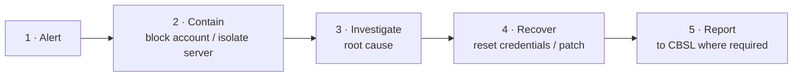

# 10 · Observability, Detection & Response

[← Data Protection](09-data-protection.md) · [README](../README.md) · Next: [Resilience →](11-resilience.md)

## Observability

### SIEM log collection
- Login attempts
- Failed transactions
- Admin user access
- Database queries
- API errors

### Monitoring dashboards
Real-time views of:
- Uptime and performance
- User behaviour
- API error rates
- Integration connectivity
- Database replication and lag

## Detection

### SIEM alerting rules
| Rule | Threat indicated |
|---|---|
| Sudden increase in fund transfers | Fraud or account takeover |
| Login from a foreign location | Credential compromise |
| Admin account active **outside business hours** | Insider misuse or a compromised admin |
| Multiple failed OTP attempts | MFA brute force or SIM-swap attempt |

### Intrusion detection system (IDS)
Watches the network for abnormal patterns, abnormal traffic, and suspicious inbound or outbound connections.

### Fraud monitoring
- Rapid or repeated transfers
- A device change followed by a high-value transaction
- Abnormal user behaviour

## Response

### Incident response process

### Intrusion prevention system (IPS)
- Automatically **blocks** confirmed malicious traffic.
- Works with the **WAF** to stop attacks in real time.
